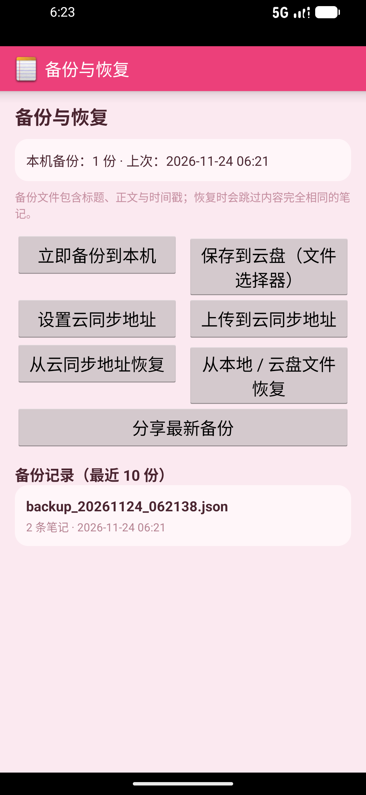
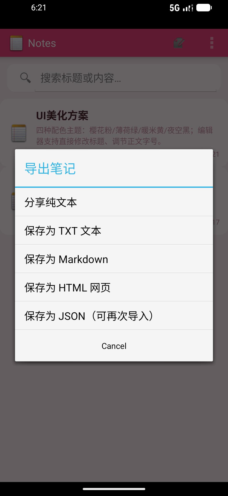

# NotePad 记事本（移动软件开发期中实验）

基于 Android 官方早期 NotePad 示例扩展的记事本应用。原项目使用 `ContentProvider + SQLite` 存储笔记，本实验在其基础上完成**时间戳显示、标题/内容搜索**两项基本要求，并扩展了 **UI 美化、笔记导出、云备份与恢复、笔记待办** 四项附加功能。

---

## 一、评分标准完成情况

| 评分项 | 分值 | 完成情况 |
| --- | --- | --- |
| 笔记列表显示时间戳 | 5 | 每条笔记卡片展示 `yyyy/MM/dd HH:mm` 修改时间 |
| 笔记内容搜索 | 5 | 搜索框实时按标题或正文 `LIKE` 过滤，支持一键清空 |
| 扩展功能 1：UI 美化 | 4 | 4 套主题、正文字号调节、卡片式列表、正文预览、可编辑标题的便签式编辑器、空状态提示 |
| 扩展功能 2：导出笔记 | 4 | 单条/全部笔记导出 TXT / Markdown / HTML / JSON，系统文件选择器（可存到云盘）与系统分享 |
| 扩展功能 3：云备份与恢复 | 4 | 带版本与 CRC 校验的 JSON 备份、本机历史备份（保留 10 份）、云盘文件保存/打开、HTTP(S) 云同步地址上传/下载、合并/覆盖两种恢复策略、自动去重 |
| 扩展功能 4：笔记待办 | 4 | 每条笔记可勾选完成状态；列表勾选框、编辑器开关、长按菜单三种切换方式；全部/待完成/已完成筛选与实时统计；完成项加删除线并置底；完成状态随备份/导出持久化 |
| README 文档 | 2 | 本文档含功能说明、技术实现、运行方式与实际界面截图 |

---

## 二、功能说明

### 1. 基本要求

- **时间戳**：列表项使用自定义 `ViewBinder` 把 `modified` 列格式化后显示，主题色随时间文字变化。
- **搜索**：使用普通 `EditText` + `TextWatcher` 实时触发 `refreshList(keyword)`，查询条件为 `title LIKE ? OR note LIKE ?`，搜索与列表刷新共用同一游标逻辑。未使用系统 `SearchView` 是因为其输入框会被强制加上 `NO_SUGGESTIONS` 标志，导致部分中文输入法不显示候选词栏。

### 2. 扩展一：UI 美化

- **四套配色主题**：樱花粉（默认）、薄荷绿、暖米黄、夜空黑（深色模式）。
- **主题属性化**：在 `res/values/attrs.xml` 中定义 `noteBg / noteCard / noteTitle / noteTime / noteAccent / noteEditorLine` 等自定义属性，布局通过 `?attr/...` 引用；切换主题只改一套属性，列表、编辑器、设置页、对话框同时生效。
- **字号调节**：设置页提供 14–26sp 的 `SeekBar`，正文编辑器读取偏好后实时应用。
- **卡片式列表**：笔记卡片显示标题、正文前两行预览、修改时间与图标；无笔记时展示引导文案。
- **编辑器优化**：新增可直接编辑的标题栏、主题色信纸横线、卡片式输入区、输入提示；横线颜色随主题变化，不再写死蓝色。

### 3. 扩展二：导出笔记

- 列表菜单「导出 / 分享」导出全部笔记；长按单条笔记或编辑器菜单可导出当前笔记。
- 提供 5 种方式：
  - **分享纯文本**：通过 `ACTION_SEND` 交给微信、邮件等应用；
  - **TXT / Markdown / HTML / JSON**：通过 `ACTION_CREATE_DOCUMENT` 调起系统文件选择器，可保存到手机存储、Google Drive、OneDrive 等任意云盘目录。
- 导出内容包含标题、创建/修改时间与正文；HTML 为带样式的完整网页并做了 HTML 转义；JSON 带 `format/version/exportedAt/count` 元信息，可用于归档。
- 文件写入在 `onActivityResult` 中通过 `ContentResolver.openOutputStream()` 完成，不申请存储权限；文件名自动带时间戳。

### 4. 扩展三：云备份与恢复

- **备份格式**：`NoteBackupManager` 生成带 `format`、`version`、`createdAt`、设备信息和 CRC32 校验和的 JSON，保存标题、正文、创建与修改时间。
- **本机历史备份**：写入应用私有目录 `backups/backup_yyyyMMdd_HHmmss.json`，采用临时文件 + 重命名保证原子性，自动保留最近 10 份。
- **云盘方式**：「保存到云盘（文件选择器）」用 `ACTION_CREATE_DOCUMENT` 把备份 JSON 直接存入云盘；「从本地 / 云盘文件恢复」用 `ACTION_OPEN_DOCUMENT` 选择备份文件。
- **HTTP 云同步方式**：可配置支持 `PUT / GET` 的 HTTP(S) 地址与 Bearer 令牌（如自建服务或 WebDAV 网关），在后台线程上传/下载备份，带连接与读取超时。
- **恢复策略**：恢复前显示备份时间与笔记数量，可选择「合并」（按标题+正文+创建时间去重）或「清空后恢复」（二次确认）；时间戳原样保留，恢复后列表自动刷新。
- **异常处理**：格式错误、版本不匹配、校验失败、网络失败、文件不可写均有明确的 Toast 提示，不静默失败。

### 5. 扩展四：笔记待办

- **数据模型**：`notes` 表新增 `done INTEGER NOT NULL DEFAULT 0` 列，数据库版本升到 3；`onUpgrade` 使用 `ALTER TABLE ADD COLUMN` 原地升级，升级后原有笔记与内容完整保留。
- **三种切换方式**：① 列表卡片左侧勾选框直接点选；② 编辑器标题下方「标记为已完成 / 取消完成」开关；③ 长按笔记的上下文菜单项（标题随当前状态动态变化）。
- **筛选与统计**：搜索框下方提供「全部 / 待完成 / 已完成」三个筛选标签，与关键字搜索组合成 `AND` 查询；顶部实时显示「待办 N · 已完成 M」。
- **视觉反馈**：已完成笔记的标题与正文加删除线并降低透明度，列表自动按 `done ASC, modified DESC` 排序，未完成在前、已完成置底。
- **持久化**：完成状态写入备份 JSON 的 `done` 字段与导出的 TXT/Markdown/HTML/JSON（状态标注），恢复时按字段还原，兼容旧备份（缺省为未完成）。

---

## 三、技术实现

| 模块 | 主要类 / 技术 |
| --- | --- |
| 数据存储 | `NotePadProvider`（SQLite + ContentProvider），`NotePad.Notes` 契约类 |
| 列表与搜索 | `NotesList`、`SimpleCursorAdapter.ViewBinder`、`EditText` + `TextWatcher`、`managedQuery` |
| 待办功能 | `notes.done` 列、`CheckBox` + `CompoundButton.OnCheckedChangeListener`、`Paint.STRIKE_THRU_TEXT_FLAG`、筛选 `selection` 拼接 |
| 主题与偏好 | `ThemeManager`、`SharedPreferences`、自定义 `attrs.xml` + 多套 `style.xml`、`Activity.setTheme()` + `recreate()` |
| 编辑器 | `NoteEditor.LinedEditText` 自绘信纸横线、`TypedArray` 解析主题属性 |
| 导出 | `NoteExportManager`（SAF `ACTION_CREATE_DOCUMENT`、`ACTION_SEND`、`org.json`、HTML 转义） |
| 备份恢复 | `NoteBackupManager`（JSON 版本化 + CRC32、原子写、去重合并、HttpURLConnection PUT/GET） |
| 备份界面 | `BackupActivity`（`AsyncTask` 网络请求、ProgressDialog、备份记录列表） |
| 设置界面 | `SettingsActivity`（`RadioGroup` + `SeekBar`） |

目录结构：

```
app/src/main/
├── java/com/example/android/notepad/
│   ├── NotePad.java / NotePadProvider.java   # 数据契约与 ContentProvider
│   ├── NotesList.java / NoteEditor.java      # 列表、搜索、编辑
│   ├── ThemeManager.java / SettingsActivity.java
│   ├── NoteExportManager.java                # 导出与分享
│   └── NoteBackupManager.java / BackupActivity.java
└── res/
    ├── values/{attrs,colors,style,strings}.xml
    ├── layout/...                            # 列表、编辑器、备份中心、设置页
    └── menu/...                              # 列表菜单、上下文菜单、编辑器菜单
```

---

## 四、编译与运行

```bash
# 项目根目录
./gradlew assembleDebug
# 输出：app/build/outputs/apk/debug/app-debug.apk
```

- 编译环境：AGP 8.12.2 / Gradle 8.13 / JDK 21，`compileSdk 34`，`minSdk 21`，`targetSdk 34`。
- 模拟器或真机安装：`adb install -r app/build/outputs/apk/debug/app-debug.apk`。
- 云同步地址为可选功能，不填不影响本机备份与云盘文件备份；应用仅申请 `INTERNET` 权限。

---

## 五、界面截图

| 功能 | 截图 |
| --- | --- |
| 笔记列表（主题、时间戳、正文预览） |  |
| 列表菜单（导出 / 备份 / 主题） |  |
| 备份与恢复中心 |  |
| 主题与字号设置 |  |
| 便签式编辑器 |  |
| 导出方式选择 |  |
| 拼音输入中文候选词 |  |
| 中文候选词栏 |  |
| 待办列表与筛选栏 |  |
| 勾选完成（删除线 + 置底） |  |
| 待办筛选（已完成） |  |
| 编辑器待办开关 |  |

---

## 六、使用路径速查

1. **切换主题/字号**：列表右上角 ⋮ → 主题与字号 → 选择配色与字号 → 保存并应用。
2. **导出笔记**：列表 ⋮ → 导出 / 分享 → 选择格式 → 在系统文件选择器中选择保存位置（可选云盘）；长按笔记可只导出该条。
3. **备份**：列表 ⋮ → 备份与恢复 → 立即备份到本机；或「保存到云盘（文件选择器）」把 JSON 存入云盘。
4. **云同步地址**：备份中心 → 设置云同步地址 → 填写支持 PUT/GET 的 URL（令牌可选）→ 上传 / 下载。
5. **恢复**：备份中心点击备份记录 → 合并；或「从本地 / 云盘文件恢复」选择 JSON 文件。
6. **待办**：点列表卡片左侧勾选框直接完成；或在编辑器勾选「标记为已完成」；也可长按笔记 → 标记为已完成。用「全部 / 待完成 / 已完成」标签筛选，顶部显示实时统计。

## 七、已知限制

- HTTP 云同步需要用户自备支持 `PUT / GET` 的服务端；项目本身不包含服务器。
- 保存到云盘依赖设备安装的文档提供者（如 Drive、OneDrive、系统文件管理器），不同提供者的界面略有差异。
- 备份为手动触发，暂未做后台自动定时备份与端到端加密。
- **中文输入**：应用本身完整支持中文输入与显示，输入框未做任何 `inputType` 限制。能否打出汉字取决于设备是否安装了中文输入法：真机启用任意中文输入法即可；模拟器若自带 Gboard，需在「系统设置 → 语言和输入法 → Gboard → 语言」中启用「简体中文」，并确保设备可访问 Google 词库下载服务（`www.gstatic.com`），否则词库下载不下来会一直提示"正在等待下载语言包"，此时打拼音只能出英文。本项目搜索框已改用普通 `EditText`，避免 `SearchView` 的 `NO_SUGGESTIONS` 标志干扰中文候选词栏。
